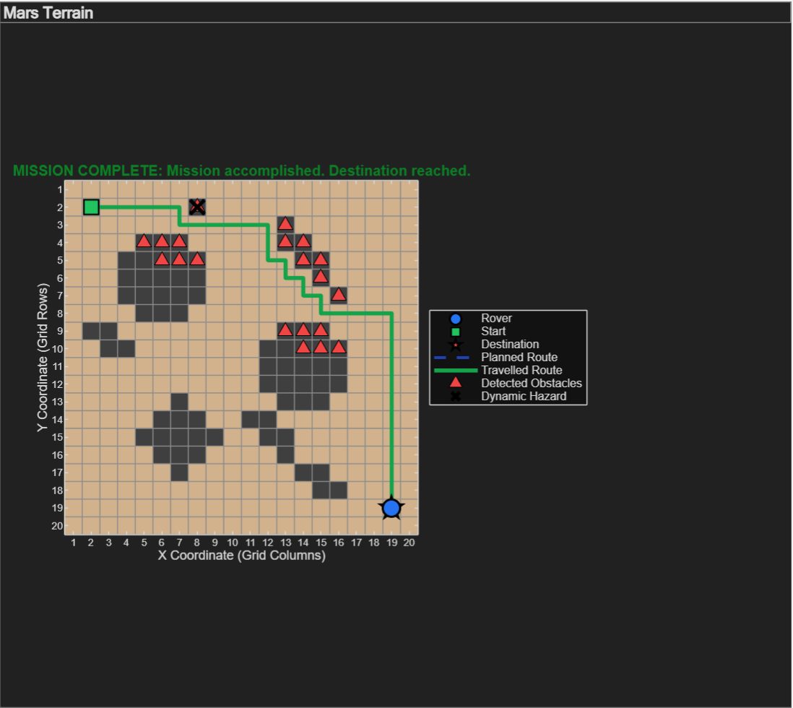

# Autonomous Planetary Rover Simulation Using MATLAB

A MATLAB simulation of an autonomous rover crossing a Mars-like terrain. The rover
plans a route with a hand-written A* algorithm, drives one grid cell at a time,
senses hazards with a range-limited proximity sensor, halts when its planned move
becomes unsafe, replans, and keeps going until it reaches the destination, runs out of
battery, or finds that no route exists. A two-panel interface shows the mission live
and a metrics module reports how the mission went.

Everything is **base MATLAB only**: no toolboxes, no Python, no Simulink.



## Contents
- [Quick start](#quick-start)
- [How it works](#how-it-works)
- [User interface](#user-interface)
- [Mission metrics and battery model](#mission-metrics-and-battery-model)
- [Project structure](#project-structure)
- [Testing](#testing)
- [Limitations](#limitations)

## Quick start
1. Open MATLAB and go to the project folder:
   ```matlab
   cd('<path to this folder>')
   ```
2. Launch the simulation:
   ```matlab
   main_rover
   ```
3. Press **Start Mission**. Press **Reset** at any time to stop and return to the start.

Useful options (name/value pairs, see `help main_rover`):
```matlab
main_rover('PauseTime', 0.03)                       % faster animation
main_rover('DynamicEvents', [])                     % no mid-mission hazards
main_rover('Battery', struct('capacity', 20, ...
                             'energyPerMove', 1))   % small battery
main_rover('AutoStart', true)                       % start immediately
```

Without a GUI, run the mission directly:
```matlab
[map, start, goal] = environment();
[finalPos, info] = mission_controller(map, start, goal, [4 2 8], 2.5, true);
calculate_metrics(info);                            % prints the metrics report
```

## How it works

**Environment** (`environment.m`). A 20x20 grid (0 = free, 1 = obstacle) with craters,
rock ridges and boulder clusters. The rover starts at `[2, 2]` and must reach `[19, 19]`.
Coordinates are `[row, col]`.

**Path planning** (`astar_path_planning.m`). A* written from scratch with plain matrices:
4-directional moves, unit step cost, Manhattan-distance heuristic, ties broken toward the
lower heuristic value. Returns the waypoint list and cost, or `[]` and `Inf` when the goal
is unreachable or an endpoint is blocked or outside the grid.

**Movement** (`rover_movement.m`). Moves exactly one cell up, down, left or right. A move
is rejected, leaving position and history unchanged, if it would leave the grid or enter
an obstacle.

**Sensing** (`obstacle_detection.m`). An omnidirectional sensor with a configurable radius
(2.5 cells by default). It reports obstacles within range, classifies them as near
(within half the radius) or distant, and flags when an obstacle lies on the remaining
planned route.

**Mission control** (`mission_controller.m`). Ties the modules together:
1. Plan an initial route.
2. Each step: apply any scheduled hazard, scan, and check whether the remaining route is blocked.
3. If blocked, stop, add the sensed obstacle to the rover's map, and replan from the current cell.
4. Otherwise take one step and spend battery.
5. Stop on success, when no route exists, when the battery cannot pay for the next move, or when aborted.

The controller keeps two maps. The **true map** is the real terrain, including hazards that
appear mid-mission; the sensor and the movement collision check use it. The **known map**
is what the rover believes: it starts with the supplied terrain and is updated only with
obstacles the sensor actually detects. A* plans on the known map, so a new hazard is only
avoided once the rover has sensed it.

A hazard is described as a row `[stepNumber, row, col]` in `dynamicEvents`; it appears after
that many moves. The default demo drops a rockfall at `[2, 8]` after 4 moves.

## User interface
`main_rover.m` builds a two-panel window with `figure`, `uipanel`, `uicontrol`, `plot`,
`set` and `drawnow`.

| Left panel | Right panel |
|---|---|
| Mars terrain and obstacles | Rover coordinates |
| Rover (blue circle), start (green square), destination (red star) | Movements |
| Planned route (blue dashed) | Battery percentage |
| Travelled route (green) | Distance travelled |
| Sensor detections (red triangles) | Obstacles detected |
| Mid-mission hazards (black X) | Path recalculations |
| | Mission completion percentage |
| | Mission status, last event, Start and Reset buttons |

The window updates after every move. At the end of each mission it shows a green
"MISSION COMPLETE" or a red "MISSION STOPPED / FAILED" message with the reason, and saves
these files to `results/`:

| File | Content |
|---|---|
| `final_map.png` | Left panel (terrain and routes) |
| `mission_dashboard.png` | Whole window |
| `mission_metrics.csv` | Mission metrics as `metric,value,unit` rows |

Images are screen captures (`getframe`), so keep the window visible while a mission ends.

## Mission metrics and battery model
`calculate_metrics.m` turns the `missionInfo` struct from the controller into a metrics struct.

| Metric | Definition |
|---|---|
| `totalDistance` | Sum of step lengths along the travelled path (grid cells) |
| `movements` | Number of valid moves |
| `obstaclesDetected` | Distinct obstacle cells the sensor saw |
| `newObstaclesDiscovered` | Obstacles the rover did not know about before sensing them |
| `pathRecalculations` | Number of replans |
| `batteryConsumed`, `batteryRemaining`, `batteryRemainingPercent` | From the battery model below |
| `completionPercent` | 100 if the goal was reached; otherwise `100 * (1 - dFinal / dStart)` using A* shortest-path distances to the goal from the start and from the final position on the final map, clamped to 0-100. `NaN` (with an explanation in `completionMethod`) if the goal is unreachable on the final map |
| `executionTimeSec` | Wall-clock computation time of the simulation, not simulated travel time |

**Battery model (deliberately simple, not a physical power model).** 100 energy units; each
valid one-cell move costs 1 unit; sensing and planning are free. The rover never starts a
move the battery cannot pay for, so the battery cannot go negative. Reaching the goal with
exactly 0 left still counts as success. Change the numbers with
`struct('capacity', ..., 'energyPerMove', ...)`.

## Project structure
```text
main_rover.m             Two-panel UI: Start / Reset, live telemetry, saves image and CSV
environment.m            20x20 terrain, start and goal
astar_path_planning.m    A* path planner (base MATLAB)
rover_movement.m         One-cell kinematics with boundary and collision checks
obstacle_detection.m     Proximity sensor and route-blocked detection
mission_controller.m     Mission loop: plan, sense, halt, replan, move; battery limit;
                         optional per-step callback used by the UI
calculate_metrics.m      Metrics and battery model
rover_visualization.m    Standalone route / mission animation
results/                 Generated images and CSV
test_*.m                 Test scripts (below)
```

## Testing
Each script prints `[PASS]` / `[FAIL]` lines and a summary. Run them from the project folder.

| Script | Covers |
|---|---|
| `test_environment` | Grid size, start/goal, reproducibility |
| `test_astar_path_planning` | Optimal paths, unreachable goals, blocked endpoints |
| `test_rover_movement`, `test_rover_movement_independent` | Moves, boundaries, collisions, history |
| `test_obstacle_detection` | Sensor radius, near/distant classification, grid edges |
| `test_dynamic_replanning` | Hazard on the route, halt and detour |
| `test_mission_controller` | Nominal, dynamic-hazard and unreachable-goal missions |
| `test_calculate_metrics` | Metric formulas and battery behavior, including integration with the controller |
| `test_rover_animation`, `test_path_visualization`, `test_visualization`, `test_mission_animation` | Animation and saved images |
| `test_main_rover` | The two-panel UI end to end: Start, Reset, telemetry, image and CSV |
| `test_full_system` | Eight scenarios with expected vs actual behavior: obstacle-free, static obstacles, new obstacle mid-move, blocked destination, no valid route, destination reached, battery depletion, moving outside the map. Writes a report to `results/full_test/` |

The test scripts only report what they actually execute; review their output in your own
MATLAB session rather than relying on this README for pass/fail status.

## Limitations
- The terrain is a fixed 20x20 grid, and movement is 4-directional with unit cost.
- The battery model is a simplified teaching model, not real rover energy use.
- The sensor is a circular range check with no line-of-sight or occlusion.
- The A* node selection scans the whole grid each step: fine for 20x20, slow for large maps.
- The image export uses screen capture, so a hidden window can produce a blank image.

## Repository
https://github.com/Neha-1502/autonomous-planetary-rover-simulation